# lovely-devin-permissions

A Devin CLI permission hook implemented in Python. It reads local `lovely-permissions.jsonc` rules and merges in `Exec(...)` allow rules from your Devin config, so commands you have already approved for Devin are not double-prompted.
See [README.md](README.md) for the underlying bash-AST library API.

> [!WARNING]
> NO GUARANTEE OF SAFETY - USE AT YOUR OWN RISK

## Usage

### Install

Install via uv (or pip):

```bash
uv add lovely-devin-permissions
```

Verify it is on your `PATH`:

```bash
uv run lovely-devin-permissions --help
```

### Register the hook

The hook is a Devin command hook. Devin passes a JSON payload on `stdin` and reads the hook's response from `stdout`. Register it for both `PreToolUse` and `PermissionRequest` on `exec` tool calls.

Create `.devin/hooks.v1.json` in the project root:

```json
{
  "PreToolUse": [
    {
      "matcher": "^(exec|write_to_process)$",
      "hooks": [
        {
          "type": "command",
          "command": "uv run lovely-devin-permissions",
          "timeout": 10
        }
      ]
    }
  ],
  "PermissionRequest": [
    {
      "matcher": "^(exec|write_to_process)$",
      "hooks": [
        {
          "type": "command",
          "command": "uv run lovely-devin-permissions",
          "timeout": 10
        }
      ]
    }
  ]
}
```

> [!NOTE]
> You can also place the same `hooks` array under the `"hooks"` key in `~/.config/devin/config.json`, `.devin/config.json`, or `.devin/config.local.json`. Run the `/hooks` command in Devin to verify the hook is loaded and which file it came from.

### First-time setup

When the hook handles a `PreToolUse` event, it rewrites the command with a leading no-op label like `: '[♡ perms: 💚 auto-approved] ...'`. That `:` is an ordinary command as far as the rules are concerned - it is checked, gated and blocked like anything else you write - so Devin's own `Exec(...)` permissions must allow it, otherwise the rewritten command itself triggers another approval.

Run once:

```bash
uv run lovely-devin-permissions --setup
```

This adds `Exec(:)` to your global Devin `permissions.allow` list so the label is auto-approved. On Windows the global config is `%APPDATA%\devin\config.json`.

To add it manually, put this in `~/.config/devin/config.json`:

```json
{
  "permissions": {
    "allow": ["Exec(:)"]
  }
}
```

> [!IMPORTANT]
> Use `Exec(:)`, not a pattern quoting the label text such as `Exec(: '[♡ perms:)`. `allowed_cmds_regex` is matched against each segment's *executed* command line, which has its quotes stripped, so a pattern containing the label's literal `'` resolves to `^: '\[♡ perms:(\s|$)` and can never match the executed `: [♡ perms: ...`. Allowing `:` is safe because the `:` builtin ignores its arguments - it runs nothing, whatever you pass it.
>
> The label is not exempt from `blocked_cmds_regex`, which is matched against the whole command as written. It holds no user payload - only a status word and, on an allow, the allow-list entry that matched - so the only way it trips a rule is a `blocked_cmds_regex` that literally matches `perms`, `auto-approved` or `♡`. Don't write those; every other command you approve would deny itself.

## What it does

The hook is invoked by Devin **only on `exec` and `write_to_process` tool calls** (bash shell commands). It does not affect other tools like `read`, `write`, or `edit`. It evaluates the command against:

1. `lovely-permissions.jsonc` configuration (parsed via shfmt-py)
2. Devin `permissions.allow` entries that look like `Exec(prefix)`

If either source approves the command, the hook lets it run. If neither matches, it asks for approval. If no `lovely-permissions.jsonc` file is found at all, the hook falls back to asking (the safe default). If a config file exists but is invalid or unusable (invalid `lovely-permissions.jsonc`, or a malformed Devin `Exec(...)` rule), the hook fails closed: it returns a `block` decision and exits with code 2, so the command is denied instead of run. Keep the config valid for the policy to apply.

## Security notes

- `allowed_cmds_regex` and `blocked_cmds_regex` must be **JSON arrays of patterns**. A bare string is rejected, not iterated: `"allowed_cmds_regex": "^ls$"` is a mistake that would otherwise become the single-character patterns `['^','l','s','$']`, and the characters `l` and `s` occur in almost any command line - so it would approve commands your wildcard had denied. Write `["^ls$"]`. (Remember `\` is escaped in JSON, so a pattern matching whitespace is `"^ls(\\s+.*)?$"` in the file.)
- `allowed_cmds_regex` and `blocked_cmds_regex` are **general regexes matched against command text**. They are not path matchers: a list entry is just a pattern, and it fires on whatever text it matches. There is no special-casing of paths, so write paths yourself (`\/etc\/shadow`, `\.ssh\/id_`) if that is what you want to block. Both lists share ONE matcher implementation; only the *scope* it is applied to differs (see the table below).
- Patterns are unanchored substring matches unless you anchor them. For example, `git` also matches `echo git`. Anchor with `^git log$` or similar. Anchoring is honored **literally** - a pattern is never "stretched" to cover more of the line than you asked for.
- `blocked_cmds_regex` is matched against the **whole raw command string** as well as per segment. Consequences: comments and quoted text are in scope (a blocked pattern matching inside a comment or inside a quoted string denies the command), and an end-anchored pattern such as `\.env$` matches only when the command actually *ends* in `.env` - `echo foo.env` is denied, but `echo ${BAR:-foo.env}` and `for f in foo.env; do :; done` are not. Use `\.env` or `\b\.env\b` if you want every mention blocked.
- `allowed_cmds_regex` is matched **per segment**, against the executed form of that segment's command line (quotes removed, backslash escapes resolved). Anchoring is literal there too, so `^git\s+log$` approves `git log` and not `git log --oneline`.
- Allowed matching is deliberately **not** done against the whole command string. We measured that whole-string matching for `allowed_cmds_regex` defeats both guard patterns the per-segment matcher exists for: the negative-lookahead guards stop working (e.g. `^find(?!.*\s-(exec|delete|ok)\b).*$` would fail to catch `find /tmp -"exec" rm`, because the raw string still shows the quotes the executed form removes), and a prefix pattern approves an entire compound line (`^ls` would approve `ls && rm -rf /`). Per-segment granularity is what prevents both. Do not "simplify" this to a single whole-command match.
- Guard patterns (negative lookaheads, e.g. `^find(?!.*\s-(exec|delete|ok)\b)`) are matched against the **executed** form of the command, where quotes are removed and backslash escapes are resolved - so write them in executed form, as you would write the command unquoted. Flags that may be quote- or backslash-split (e.g. `find -exec` as `-e"x"ec` / `-ex\ec`) must be covered with a character class such as `-e["x]ec` or a plain executed-form token - a guard with a **literal** quote character (e.g. `(?!.*-e"xec)`) can never trip, because the executed form contains no quotes.
- **Nothing is auto-approved by default, and that includes bash's own conditionals.** `[` (and its `test` spelling), `true`, `false` and `:` do no work - `[ -f x ]` compares strings, it never runs anything - but bash implements them as real builtins, so the evaluator reports them as commands and they must be allow-listed like any other. So `[ -n "$p" ] && ls`, `if true; then ...; fi` and `while false; do ...; done` all prompt until the builtin itself is listed. This is deliberate: an allow-list you did not write is not a decision you made. See [Shell conditionals and status builtins](#shell-conditionals-and-status-builtins) for the patterns to add. The asymmetry with `[[ ... ]]` and `(( ... ))` is real but not a hole - those are parsed as expressions rather than commands, so they produce no command segment at all and never appear in an allow-list. All of these are still fully checked by `blocked_cmds_regex`: `[ -f /etc/passwd ]` is denied by a `\/etc` pattern whether or not `[` is allow-listed.
- This is a policy layer, not a sandbox. It statically analyzes the command as written: backtick and `$(...)` command substitutions, process substitutions, brace groups (`{ ...; }`), subshells, functions, loops, conditionals, and heredoc bodies are all walked and their inner commands checked, so no syntax form silently skips evaluation. Environment assignment prefixes like `a=1 rm -rf /` are detected and evaluated separately via the `variable_assignment` policy. It is still best-effort static analysis, not a runtime boundary: things bash only reveals at runtime (expansion results, substitution output) cannot be verified, and anything the parser cannot analyze falls through to the `error` policy. Use it as guard-rails against accidental execution, not as a security boundary around untrusted input.

## Configuration files

### `lovely-permissions.jsonc`

The primary config is `lovely-permissions.jsonc`. It is read from three locations, **lowest precedence first** (each one overrides the one before it):

- `~/.config/devin/lovely-permissions.jsonc` (global)
- `.devin/lovely-permissions.jsonc` (project - to commit/share)
- `.devin/lovely-permissions.local.jsonc` (personal local override - not to commit/share)

The merge is deep: nested objects merge key by key, and **regex lists are concatenated rather than replaced**, so a `blocked_cmds_regex` in the project config adds to the global one instead of shadowing it. A key defined at two levels with a different scalar value logs a conflict warning.

On Windows, the global path is `%APPDATA%\devin\lovely-permissions.jsonc`.

A typical project config:

```json
{
  "*": "ask",
  "bash": {
    "*": "ask",
    "error": "ask",
    "allowed_cmds_regex": ["^git status$", "^git (log|ls-files)$"],
    "blocked_cmds_regex": ["\\/etc", "\\.ssh\\/id_", "\\.env$"],
    "command_substitution": "ask",
    "process_substitution": "ask",
    "subshell": "ask",
    "variable_assignment": "ask"
  }
}
```

At the config root, `*` sets the overall wildcard (default `"ask"`). Inside `bash`, `*` is the bash-scope wildcard and falls back to the config-root `*`. Any permission-level bash option that is omitted (`error`, `command_substitution`, `process_substitution`, `subshell`, `variable_assignment`, redirection, and background policies) inherits the bash-scope `*`, then the config-root `*`, then defaults to `"ask"`. The regex list keys (`allowed_cmds_regex`, `blocked_cmds_regex`) instead default to empty lists.

The `bash` config key supports these keys:

| Key                                     | Type                                   | Description                                                                                                                                         |
| --------------------------------------- | -------------------------------------- | --------------------------------------------------------------------------------------------------------------------------------------------------- |
| `*`                                     | `"allow" \| "ask" \| "deny"`           | Bash-scope wildcard. If omitted, inherits the config-root `*`, which defaults to `"ask"`, so unknown commands prompt the user for approval            |
| `error`                                 | `"allow" \| "ask" \| "deny"`           | Policy applied when a command cannot be analysed (unparseable/malformed bash, shfmt timeout). If omitted, inherits `*`. A missing or unstartable shfmt binary always asks instead, whatever this says. Set to `"ask"` or `"deny"` so broken syntax is not silently auto-approved under `"*": "allow"` |
| `command_substitution`                  | `"allow" \| "ask" \| "deny"`           | Policy for `$(...)` / backtick command substitutions. If omitted, inherits `*`                                                                      |
| `process_substitution`                  | `"allow" \| "ask" \| "deny"`           | Policy for `<(...)` / `>(...)` process substitutions. If omitted, inherits `*`                                                                      |
| `subshell`                              | `"allow" \| "ask" \| "deny"`           | Policy for `( ... )` subshell groups. If omitted, inherits `*`                                                                                      |
| `background_execution`                  | `"allow" \| "ask" \| "deny"`           | Policy for trailing `&` background execution. If omitted, inherits `*`                                                                              |
| `input_redirection`                     | `"allow" \| "ask" \| "deny"`           | Policy for input/read redirections (`<`, `<<`, `<<<`, `<&`). If omitted, inherits `*`                                                               |
| `output_redirection.*`                  | `"allow" \| "ask" \| "deny"`           | `output_redirection` level wildcard. Default permission for any output redirection not otherwise matched. If omitted, inherits `*`                   |
| `output_redirection.stderr_to_dev_null` | `"allow" \| "ask" \| "deny"`           | Permission for discarding stderr with `2>/dev/null`                                                                                                 |
| `output_redirection.stderr_to_stdout`   | `"allow" \| "ask" \| "deny"`           | Permission for duplicating stderr to stdout with `2>&1`                                                                                             |
| `output_redirection.stdout_to_dev_null` | `"allow" \| "ask" \| "deny"`           | Permission for discarding stdout with `>/dev/null`                                                                                                  |
| `output_redirection.other`               | `"allow" \| "ask" \| "deny"`           | Permission for every other write (`> file`, `>> file`, `>\| file`) - anything that is neither a discard nor an fd duplication                      |
| `output_redirection`                    | `"allow" \| "ask" \| "deny"` or object | Parent key for output redirection policy. A string applies to all output redirections. An object uses the keys below. If omitted, inherits `*`. A kind the evaluator cannot produce is a config error, not a silently ignored key |
| `variable_assignment`                   | `"allow" \| "ask" \| "deny"`           | Policy for standalone variable assignments (`FOO=bar`) and variable assignment before commands (`FOO=bar ls`). If omitted, inherits `*`              |
| `allowed_cmds_regex`                    | `string[]`                             | General regexes that approve a command when matched against the **executed command line of each segment** (quotes removed, backslash escapes resolved). Unanchored - anchor with `^` and `$`. Never matched against the whole command, so one segment's match cannot approve a compound line |
| `blocked_cmds_regex`                    | `string[]`                             | General regexes that deny a command when matched against the **whole raw command string** as well as **each segment's joined line** - the same matcher as `allowed_cmds_regex`, a wider scope. Not path-specific; write your own path patterns. Unanchored substrings - anchor with `^`/`$`/`\b` as needed, and note anchoring is literal against the whole command (`\.env$` only denies a command that ends in `.env`). Comments and quoted text are in scope. Also applied to redirection targets, substitution contents, and heredoc bodies. |

A misspelled redirection kind is a config error, not a silently ignored key. `{"stderr_to_devnull": "deny"}` looks like it blocks stderr discards and would have permitted every one of them; the config is now rejected, and because the hook fails closed on an invalid config the command is blocked until it is fixed. The four kinds above are the only ones `classify_output_redirection` can return, so any other key could never have been consulted in the first place.

>`error` covers commands the parser cannot handle (e.g. `echo "unclosed`, `(((invalid`). It does not cover a missing shfmt: that is a broken install rather than a command, so every command asks until shfmt is back, even under `"error": "allow"` or `"error": "deny"`. Because both `allowed_cmds_regex` and `blocked_cmds_regex` are skipped for such input, the `error` policy decides the outcome - defaulting to the bash `*` wildcard. Set it to `"ask"` (recommended) or `"deny"` so malformed but bash-accepted syntax is never silently auto-approved under `"*": "allow"`.

### Shell conditionals and status builtins

`[`, `test`, `true`, `false` and `:` are part of the shell language, but they are commands as far as bash is concerned - `[` is a builtin binary and `/usr/bin/[` exists on most systems - so the evaluator reports each of them as a command segment. None of them is auto-approved; that is the point, since an allow-list you did not write is not a decision you made. The practical consequence is that ordinary shell control flow prompts until you list the builtin:

```bash
[ -n "$p" ] && ls                 # -> asks:  "[" does not match allowed patterns; wildcard policy is ask
if true; then ls; fi              # -> asks:  "true" does not match allowed patterns; wildcard policy is ask
while false; do ls; done          # -> asks:  "false" does not match allowed patterns; wildcard policy is ask
ls                                # -> allowed (if ^ls is listed)
```

Add the ones you actually use, anchored like any other command:

```jsonc
"allowed_cmds_regex": [
  "^\\[(\\s+.*)?$",   // [ -n "$p" ] && ...
  "^test(\\s+.*)?$",  // test -f file && ...
  "^true(\\s.*)?$",   // if true; then ...; fi
  "^false(\\s.*)?$",  // while false; do ...; done
  "^:(\\s.*)?$"       // the : no-op
]
```

The `\\[` and `\\s` are double-escaped because these are JSON strings. Note the trailing `.*` on `[` and `test`: their arguments (`-n`, `-f`, the closing `]`) are ordinary operands, so the pattern must tolerate them. `true`, `false` and `:` take no useful arguments, hence `(\\s.*)?$`.

Listing a builtin only approves *it*. Everything the conditional guards still has to earn its own pattern, so with the list above `[ -n "$p" ] && rm -rf /` still asks for `rm`, and `if true; then rm -rf /; fi` still asks too.

Two things this does **not** weaken. Blocked patterns are checked independently and still reach these segments - `[ -f /etc/passwd ]` is denied by a `\/etc` pattern whether or not `[` is allow-listed. And substitutions nested inside a conditional are still extracted as the commands they run: `[ "$(cat secret)" = x ]` reports `cat`, which is checked on its own.

For contrast, `[[ ... ]]` and `(( ... ))` are parsed as bash *expressions* rather than commands, so the construct itself produces no command segment and never needs allow-listing. (A substitution *inside* one still runs and is still extracted: `[[ $x == $(cmd) ]]` reports `cmd`, and `(( x=$(cmd) ))` reports `cmd`. It is the brackets that are invisible, not what they contain.) Only the single-bracket `[ ... ]` form - which really is a command - appears in an allow-list. If a command using `[ ... ]` or `if true; ...` prompts unexpectedly, that is this policy working as intended, not a misparse.

### Wrapper and interpreter commands

Many commands take *another command* as an argument. The evaluator reports the wrapper, and the wrapped command is an argument rather than a command segment, so it is **not** checked by `allowed_cmds_regex` on its own:

| Form | Reported as | The real command is |
| --- | --- | --- |
| `sudo rm -rf /`, `env FOO=1 rm -rf /` | `sudo`, `env` | an argument |
| `nice`, `nohup`, `command`, `timeout`, `stdbuf`, `ionice`, `chroot`, `setsid` | the wrapper | an argument |
| `xargs rm -rf /` | `xargs` | an argument |
| `sh -c "rm -rf /"`, `bash -c`, `eval "rm -rf /"` | `sh`, `bash`, `eval` | a string of shell source |
| `python3 -c "..."`, `node -e`, `perl -e`, `awk 'BEGIN{system("...")}'` | the interpreter | a string of that language |
| `find . -exec rm {} +`, `find . -execdir rm {} +` | `find` | an argument |
| `sh <<EOF` … `rm -rf /` … `EOF` | `sh` | a heredoc body |

So an allow-list entry for a wrapper approves the whole line:

```bash
# with "^sh" allow-listed, both of these are approved
sh -c "rm -rf /"
sh -c "cat /etc/passwd"
```

**`blocked_cmds_regex` is unaffected.** It is matched against the whole raw command string, so any pattern in the wrapper's arguments still denies the command - `sh -c "cat /etc/passwd"` is denied by `\/etc`, and a heredoc body is scanned as text. The exposure is specific to the allow side.

Prefer calling the target command directly over wrapping it. If you do need a wrapper, either anchor it tightly (`^sudo\s+-\w+\s+\w+\s+rm$` is still loose, but `^sudo$` approves nothing useful) or use a guard pattern that refuses the wrapper when a dangerous argument is present, the way the `find` examples in the test suite do:

```jsonc
"^find(?!.*\s-(exec|execdir|delete|ok)\b).*$"
```

Interpreter code strings (`python3 -c`, `node -e`, `perl -e`) are not shell and cannot be parsed as such; treat an allow-list entry for an interpreter as approving whatever that language can do.

### A parameter expansion in command-name position

When a parameter expansion *is* the command, bash expands it and runs the first resulting word. `${V:-mytool --flag}` runs `mytool` with `--flag`; `${V-cmd}` behaves the same for the `-` form. The evaluator reports one command whose name is the expansion text, `${V:-mytool --flag}`, because only the runtime value is the actual command name:

| | |
|---|---|
| `${V:-$(rm -rf /)}` | The `$(...)` is a nested command, so `rm` **is** extracted and gated separately. |
| `${V:-rm -rf /}` | The default is a plain word, not a command, so nothing is extracted. |

What still protects you: `blocked_cmds_regex` is matched against the command as written, so a pattern for `rm -rf` or `/etc` denies `${V:-rm -rf /}` and `${V:-/etc/passwd}` in every spelling we tested. And the default posture is to prompt - `${V:-rm -rf /}` is *not* allow-listed, so it asks rather than running.

What does not: under `"*": "allow"` the opaque expansion is approved along with everything else, so the command it becomes runs ungated. That is the same posture as any other unrecognised command under a blanket allow, and it is why an allow-list is the safer configuration. Nor can a pattern see a value that only exists after expansion: `${V:-cm*}` contains the literal `cm*`, so a blocked pattern for `cmdx` does not match it.

If you need this gated, list the command that can appear there and prefer the `$(...)` form, whose inner command is checked.

### How policy levels combine

Every bash option takes `"allow"`, `"ask"` or `"deny"`, and they do not all mean the same thing:

- **`deny` is absolute.** It wins over the wildcard, over `allowed_cmds_regex`, and over any other policy that matched, and **it cannot be overridden at runtime** - the hook returns `block` and the user must change the config. This holds for *every* level-bearing key: `command_substitution`, `process_substitution`, `subshell`, `variable_assignment`, the redirection and background policies, and `error` (except that a missing shfmt always asks - see `error` above).
- **`ask` only prevents auto-approval.** It downgrades a verdict that would otherwise have been `allow`. If the command is already prompting - because the wildcard is `ask`, or because an allow pattern missed - an `ask` on another key changes nothing, and an `ask` can never soften a `deny` into a prompt.
- **`allow`** only matters where something would otherwise have prompted; it does not override a `blocked_cmds_regex` hit.

So a `deny` is inert only when the command never reaches the evaluation that would apply it (for example a policy on a construct the command does not contain).

> [!IMPORTANT]
> Setting `"deny"` on a construct key while leaving the wildcard at `"ask"` **hard-blocks** the command rather than prompting. A construct `deny` is absolute: it is applied whatever verdict the wildcard produced, and no approval at runtime can lift it - only a config change can. If you want a prompt instead, use `"ask"`.

When a construct policy blocks, the reason says so explicitly - `command substitution denied in config`, `subshell (...) denied in config` - so a blocked command is never reported as merely "requires approval". The same wording appears when a nested command inside a substitution fails the allow-list and the policy is `deny`. The allowed counterparts exist too - `command substitution allowed`, `subshell (...) allowed` - so an auto-approval names the rule that permitted it rather than leaving you to infer it.

### What a verdict is allowed to say

One rule, applied once the verdict is final: **a reason is shown if and only if the level it argues for is the level that was reached.** A consequence worth knowing when you read a refusal is that it names only its own reasons - never a matched allow pattern, never an approved construct. If a command was refused, nothing in the reason says part of it had been allowed, and the reverse holds for a prompt: it tells you what needs approving and nothing that was already approved. Both directions matter because the alternative is a prompt that lists work already done, which is how a prompt becomes too long to read.

### Devin config

Devin config is read from the same places Devin uses, lowest precedence first:

- `~/.config/devin/config.json` (global; `%APPDATA%\devin\config.json` on Windows)
- `.devin/config.json` (project)
- `.devin/config.local.json` (personal override)

Any `permissions.allow` entry that matches `Exec(prefix)` is converted into an anchored regex and appended to the effective `allowed_cmds_regex` list.

```json
{
  "permissions": {
    "allow": ["Exec(git log)", "Exec(git ls-files)", "Read(**)"]
  }
}
```

From the example above, the hook adds `^git log(\s|$)` and `^git ls-files(\s|$)`. Non-`Exec` rules such as `Read(**)` are ignored by this hook; Devin enforces those itself.

> [!WARNING]
> As you can tell, the conversion results in partially anchored regexes. For example, `Exec(git log)` becomes `^git log(\s|$)`, which matches `git log` but also matches `git log --oneline` or any other argument after the pattern. It is therefore recommended NOT to use Devin's "allow" permissions at all and instead use lovely-permissions anchored regexes for more precise control. If you do use Devin's "allow" permissions, be aware of the potential for over-approving commands.

## How the merge works

- Devin `Exec(...)` allow rules are appended to any `allowed_cmds_regex` from `lovely-permissions.jsonc`.
- If `lovely-permissions.jsonc` has no bash config but Devin has `Exec(...)` rules, the hook synthesizes a bash config with the config-root `*` as its wildcard (so `"*": "ask"` unless you set otherwise) plus the Devin-derived regexes, so Devin-allowed commands auto-approve while everything else follows the root wildcard.
- Malformed `Exec(...)` entries (for example `Exec()` or `Exec((unclosed`) make the effective bash config fail to load, so **every command is blocked** (`config error (blocked)`, exit code 2) until they are fixed. `--show-config` reports the error explicitly and exits 1. Note this is the block, not the ask, fallback - a broken Devin config would also break the hook's own `Exec(:)` label auto-approval, so failing open on it would run commands nobody approved.

## Devin CLI Hook

The hook is registered for both `PreToolUse` and `PermissionRequest` on `exec` and `write_to_process` tool calls. Both receive the event as JSON on `stdin` and return their response as JSON on `stdout`.

### PreToolUse

```mermaid
---
config:
  flowchart:
    subGraphTitlePosition: top-left
---
flowchart TD
    A[Devin CLI Agent] -->|"JSON on stdin"| C{verdict}

    subgraph lovely[lovely-devin-permissions]
        C -->|"✅ allow"| D["<pre style=text-align:left>{<br/>  &quot;decision&quot;: &quot;approve&quot;,<br/>  &quot;hookSpecificOutput&quot;: {<br/>    &quot;hookEventName&quot;: &quot;PreToolUse&quot;,<br/>    &quot;updatedInput&quot;: {<br/>      &quot;command&quot;: &quot;: '[♡ perms: 💚 auto-approved] &lt;reason&gt' 💚 ; &lt;cmd&gt;&quot;<br/>    }<br/>  }<br/>}</pre>"]
        C -->|"❌ deny"| E["<pre style=text-align:left>{<br/>  &quot;decision&quot;: &quot;block&quot;,<br/>  &quot;reason&quot;: &quot;[♡ perms: ❤️ auto-rejected] &lt;reason&gt;&quot;,<br/>  &quot;hookSpecificOutput&quot;: {<br/>    &quot;hookEventName&quot;: &quot;PreToolUse&quot;,<br/>    &quot;updatedInput&quot;: {<br/>      &quot;command&quot;: &quot;: '[♡ perms: ❤️ auto-rejected] &lt;reason&gt;' ❤️ ; &lt;cmd&gt;&quot;<br/>    }<br/>  }<br/>}</pre>"]
        C -->|"❔ ask"| F["<pre style=text-align:left>{<br/>  &quot;hookSpecificOutput&quot;: {<br/>    &quot;hookEventName&quot;: &quot;PreToolUse&quot;,<br/>    &quot;updatedInput&quot;: {<br/>      &quot;command&quot;: &quot;: '[♡ perms: 💛 REQUIRES-USER-APPROVAL] &lt;reason&gt' 💛 ; &lt;cmd&gt&quot;<br/>    }<br/>  }<br/>}</pre>"]
    end

    D -->|"JSON stdout, exit code 0"| R[Devin CLI Agent]
    E -->|"JSON stdout, exit code 2"| R
    F -->|"JSON stdout, exit code 0"| R

    style lovely fill:#000000,stroke:#22c55e,stroke-width:2px
    style A stroke:#0000ff,stroke-width:2px
    style R stroke:#0000ff,stroke-width:2px
```



Fired *before* the command runs. The hook modifies the command by prepending a no-op `:` label with user-facing status info - green 💚 for auto-approved, red ❤️ for auto-rejected, yellow 💛 for commands needing user approval. The label matches `Exec(:)` in Devin's `permissions.allow` (added by `--setup`), so Devin auto-approves the label - but the actual command after `;` is still assessed by both lovely-devin-permissions and Devin's permission system.

### PermissionRequest

```mermaid
---
config:
  flowchart:
    subGraphTitlePosition: top-left
---
flowchart TD
    A[Devin CLI Agent] -->|"JSON on stdin"| C{verdict}

    subgraph lovely[lovely-devin-permissions]
        C -->|"✅ allow"| D["<pre style=text-align:left>{ &quot;decision&quot;: &quot;approve&quot; }</pre>"]
        C -->|"❌ deny"| E["<pre style=text-align:left>{<br/>  &quot;decision&quot;: &quot;block&quot;,<br/>  &quot;reason&quot;: &quot;[♡ perms: ❤️ auto-rejected] &lt;reason&gt;&quot; <br/>}</pre>"]
        C -->|"❔ ask"| F["empty response<br/>(Devin CLI prompts the user with the built-in prompt)"]
    end

    D -->|"JSON stdout, exit code 0"| R[Devin CLI Agent]
    E -->|"JSON stdout, exit code 2"| R
    F -->|"empty stdout, exit code 0"| R

    style lovely fill:#000000,stroke:#22c55e,stroke-width:2px
    style A stroke:#0000ff,stroke-width:2px
    style R stroke:#0000ff,stroke-width:2px
```



Fired when the permission system needs a decision on an `exec` tool call. The hook responds with a simple approve / block decision, or returns nothing so Devin falls through to its own user prompt.

Both hooks share the same evaluation engine: config is loaded from `lovely-permissions.jsonc` (merged across global / project / local) and any `Exec(...)` rules from Devin's `permissions.allow` are appended to `allowed_cmds_regex`. The command is parsed with shfmt, walked segment-by-segment, and the overall allow / ask / block verdict is returned.

## Hook output and exit codes

The hook prints a JSON object to `stdout` and exits with a code:

| Code  | Meaning                                                                                                                                                             |
| ----- | ------------------------------------------------------------------------------------------------------------------------------------------------------------------- |
| `0`   | Success - the hook returned an `approve`, `ask`, or `updatedInput` decision.                                                                                        |
| `2`   | Block - the command was denied. Also used when the hook fails closed: unparseable stdin (`[♡ perms: ERROR]` reason) or an invalid/unusable permissions config.       |
| Other | Error in a non-hook mode only (e.g. `--setup`/`--show-config` failure, or the binary could not start). Hook mode never lets a command run when it cannot compute a verdict. |

When the hook cannot compute a verdict at all - unparseable stdin (invalid JSON, a JSON value that is not an object, or an `exec`/`write_to_process` event whose `tool_input` is not an object) - it fails closed: it prints `{ "decision": "block", "reason": "[♡ perms: ERROR] ..." }` on `stdout` and exits with code `2`, so the tool is denied rather than run. Because the command text is unavailable in those cases, the `PreToolUse` block response omits `hookSpecificOutput.updatedInput`; the bare `decision: block` still prevents execution.

For `PreToolUse` the hook rewrites the command with a leading no-op label for user visibility/convenience:

```json
{
  "hookSpecificOutput": {
    "hookEventName": "PreToolUse",
    "updatedInput": {
      "command": ": '[♡ perms: 💚 auto-approved] command matches allowed pattern: ^git' 💚 ; git log -1"
    }
  }
}
```

For `PermissionRequest` the response is a simple decision:

```json
{ "decision": "approve" }
```

or

```json
{ "decision": "block", "reason": "..." }
```

Allowed commands get `: '[♡ perms: 💚 auto-approved] ...'`, blocked commands get `: '[♡ perms: ❤️ auto-rejected]'`, and commands that need user approval get `: '[♡ perms: 💛 REQUIRES-USER-APPROVAL] ...'`. The `:` built-in is a no-op, so the label does not change the command's behavior.

## CLI usage

To add the label permission to Devin config:

```bash
uv run lovely-devin-permissions --setup
```

To test a command against your config without running a full Devin session:

> [!NOTE]
> Your effective config is affected by the path you are running this in, where the directory you are running in might have "project" or "local" overrides. Run this in the same directory you would run Devin

```bash
uv run lovely-devin-permissions --test "git status"
```

This simulates a `PreToolUse` event and shows whether the command would be approved, blocked, or require user approval, along with the reason.

To inspect the effective bash permissions config for the current directory:

```bash
uv run lovely-devin-permissions --show-config
```

It prints a JSON object with:

- `files`: an array of objects, one per config file considered, with `path` and `exists` keys. This includes global, project, and local (`*.local.jsonc` / `config.local.json`) overrides.
- `effectiveConfig`: the effective bash tool config, with any Devin `Exec(...)` allow rules merged into `allowed_cmds_regex`.

This is useful for confirming which rules Devin will see before running a session.

## Troubleshooting

- Run `uv run lovely-devin-permissions --show-config` to see which files were read and the effective bash config.
- If every command is blocked with `invalid permissions config (blocked)` or `config error (blocked)`, one of the source configs is invalid: an invalid `lovely-permissions.jsonc` (a completely missing config falls back to ask instead) or a malformed Devin `Exec(...)` allow rule. Run `--show-config` to see the failures.
- If every command still asks for approval when used as `PreToolUse`, run `--setup` to add the `Exec(:)` label permission to Devin.

## Example Config

> [!WARNING]
> NO GUARANTEE OF SAFETY - USE AT YOUR OWN RISK

Recommended to be used with Devin in **normal** mode where it will ask for permission for commands or other tools not explicitly allowed.

Example `permissions` in Devin config:

```json
  "permissions": {
    "allow": [
      "Exec(:)"
    ]
  },

```

Example `lovely-permissions.jsonc`:

```json
{
  "bash": {
    "*": "ask",
    "error": "ask",
    "output_redirection": {
      "*": "ask",
      "stderr_to_dev_null": "allow",
      "stderr_to_stdout": "allow"
    },
    "variable_assignment": "ask",
    "command_substitution": "allow",
    "process_substitution": "allow",
    "subshell": "allow",
    "blocked_cmds_regex": ["\\/etc", "\\.env$", "\\.envrc$"],
    "allowed_cmds_regex": [
      "^cat\\s+.+$",
      "^echo(\\s+.*)?$",
      "^fd(?!.*\\s+(-x|-X)).*$",
      "^file\\s+.+$",
      "^find(?!.*\\s-(exec|delete|ok)(\\s|;|$)).*$",
      "^gh\\s+pr\\s+(view|diff)\\s+.+$",
      "^gh\\s+run\\s+view\\s+.+$",
      "^gh\\s+search\\s+.+$",
      "^git\\s+(?!.*--output\\b)(-C\\s+[\\w./\\\\-]+\\s+)?(log|diff|status|show|ls-files|ls-tree)(\\s+.*)?$",
      "^git\\s+(?!.*--output\\b)(-C\\s+[\\w./\\\\-]+\\s+)?branch\\s+(--show-current|-a)$",
      "^git\\s+(?!.*--output\\b)(-C\\s+[\\w./\\\\-]+\\s+)?merge-base\\s+.+$",
      "^git\\s+(?!.*--output\\b)(-C\\s+[\\w./\\\\-]+\\s+)?remote\\s+-v$",
      "^git\\s+(?!.*--output\\b)(-C\\s+[\\w./\\\\-]+\\s+)?rev-parse\\s+.+$",
      "^git\\s+(?!.*--output\\b)(-C\\s+[\\w./\\\\-]+\\s+)?tag\\s+-l$",
      "^grep\\s+.+$",
      "^head(\\s+.*)?$",
      "^ls(\\s+.*)?$",
      "^rg\\s+.+$",
      "^sed\\s+(?!\\s+(-e|-i)\\b)-n\\s+('?([0-9]+,)?[0-9]+p'?)(\\s+.*)?$",
      "^sort(?!\\s+(-o|--output)\\b).*$",
      "^tail(\\s+.*)?$",
      "^true$",
      "^wc(\\s+-(l|c|w)?)?.*$",
      "^which\\s+.+$",
      "^xargs\\s+grep\\s.+$"
    ]
  }
}
```
