# lovely-devin-permissions

A Devin CLI permission hook implemented in Python. It reads local `lovely-permissions.jsonc` rules and merges in `Exec(...)` allow rules from your Devin config, so commands you have already approved for Devin are not double-prompted.
See [README.md](README.md) for the underlying bash-AST library API.

> [!WARNING]
> NO GUARANTEE OF SAFETY - USE AT YOUR OWN RISK

## Usage

### Install

Install via uv (or pip):

```bash
uv add lovely-devin-permissions
```

Verify it is on your `PATH`:

```bash
uv run lovely-devin-permissions --help
```

### Register the hook

The hook is a Devin command hook. Devin passes a JSON payload on `stdin` and reads the hook's response from `stdout`. Register it for both `PreToolUse` and `PermissionRequest` on `exec` tool calls.

Create `.devin/hooks.v1.json` in the project root:

```json
{
  "PreToolUse": [
    {
      "matcher": "^(exec|write_to_process)$",
      "hooks": [
        {
          "type": "command",
          "command": "uv run lovely-devin-permissions",
          "timeout": 10
        }
      ]
    }
  ],
  "PermissionRequest": [
    {
      "matcher": "^(exec|write_to_process)$",
      "hooks": [
        {
          "type": "command",
          "command": "uv run lovely-devin-permissions",
          "timeout": 10
        }
      ]
    }
  ]
}
```

> [!NOTE]
> You can also place the same `hooks` array under the `"hooks"` key in `~/.config/devin/config.json`, `.devin/config.json`, or `.devin/config.local.json`. Run the `/hooks` command in Devin to verify the hook is loaded and which file it came from.

### First-time setup

When the hook handles a `PreToolUse` event, it rewrites the command with a harmless leading no-op label like `: '[♡ perms: 💚 auto-approved] ...'`. Devin's own `Exec(...)` permissions must allow that no-op command (`:`) / prefix, otherwise the rewritten command itself triggers another approval.

Run once:

```bash
uv run lovely-devin-permissions --setup
```

This adds `Exec(: '[♡ perms:)` to your global Devin `permissions.allow` list so the label is auto-approved. On Windows the global config is `%APPDATA%\devin\config.json`.

To add it manually, put this in `~/.config/devin/config.json`:

```json
{
  "permissions": {
    "allow": ["Exec(: '[♡ perms:)"]
  }
}
```

## What it does

The hook is invoked by Devin **only on `exec` and `write_to_process` tool calls** (bash shell commands). It does not affect other tools like `read`, `write`, or `edit`. It evaluates the command against:

1. `lovely-permissions.jsonc` configuration (parsed via shfmt-py)
2. Devin `permissions.allow` entries that look like `Exec(prefix)`

If either source approves the command, the hook lets it run. If neither matches, it asks for approval. If no `lovely-permissions.jsonc` file is found at all, the hook falls back to asking (the safe default). If a config file exists but is invalid or unusable (invalid `lovely-permissions.jsonc`, or a malformed Devin `Exec(...)` rule), the hook fails closed: it returns a `block` decision and exits with code 2, so the command is denied instead of run. Keep the config valid for the policy to apply.

## Security notes

- Patterns in `allowed_cmds_regex` and `blocked_paths_regex` are unanchored substring matches unless you anchor them. For example, `git` also matches `echo git`. Anchor with `^git log$` or similar.
- This is a policy layer, not a sandbox. It statically analyzes the command as written: backtick and `$(...)` command substitutions, process substitutions, brace groups (`{ ...; }`), subshells, functions, loops, conditionals, and heredoc bodies are all walked and their inner commands checked, so no syntax form silently skips evaluation. Environment assignment prefixes like `a=1 rm -rf /` are detected and evaluated separately via the `variable_assignment` policy. It is still best-effort static analysis, not a runtime boundary: things bash only reveals at runtime (expansion results, substitution output) cannot be verified, and anything the parser cannot analyze falls through to the `error` policy. Use it as guard-rails against accidental execution, not as a security boundary around untrusted input.

## Configuration files

### `lovely-permissions.jsonc`

The primary config is `lovely-permissions.jsonc`. It is read from three locations, in order of precedence:

- `~/.config/devin/lovely-permissions.jsonc` (global)
- `.devin/lovely-permissions.jsonc` (project - to commit/share)
- `.devin/lovely-permissions.local.jsonc` (personal local override - not to commit/share)

On Windows, the global path is `%APPDATA%\devin\lovely-permissions.jsonc`.

A typical project config:

```json
{
  "*": "ask",
  "bash": {
    "*": "ask",
    "error": "ask",
    "allowed_cmds_regex": ["^git status$", "^git (log|ls-files)$"],
    "blocked_paths_regex": ["^/etc"],
    "subshell": "ask",
    "variable_assignment": "ask"
  }
}
```

At the config root, `*` sets the overall wildcard (default `"ask"`). Inside `bash`, `*` is the bash-scope wildcard and falls back to the config-root `*`. Any permission-level bash option that is omitted (`error`, `subshell`, `variable_assignment`, redirection, and background policies) inherits the bash-scope `*`, then the config-root `*`, then defaults to `"ask"`. The regex list keys (`allowed_cmds_regex`, `blocked_paths_regex`) instead default to empty lists.

The `bash` config key supports these keys:

| Key                                     | Type                                   | Description                                                                                                                                         |
| --------------------------------------- | -------------------------------------- | --------------------------------------------------------------------------------------------------------------------------------------------------- |
| `*`                                     | `"allow" \| "ask" \| "deny"`           | Bash-scope wildcard. If omitted, inherits the config-root `*`, which defaults to `"ask"`, so unknown commands prompt the user for approval            |
| `error`                                 | `"allow" \| "ask" \| "deny"`           | Policy applied when a command cannot be analysed (unparseable/malformed bash, shfmt failure). If omitted, inherits `*`. Set to `"ask"` or `"deny"` so broken syntax is not silently auto-approved under `"*": "allow"` |
| `subshell`                              | `"allow" \| "ask" \| "deny"`           | Policy for subshells and command substitutions (`$(...)`, backticks). If omitted, inherits `*`                                                      |
| `background_execution`                  | `"allow" \| "ask" \| "deny"`           | Policy for trailing `&` background execution. If omitted, inherits `*`                                                                              |
| `input_redirection`                     | `"allow" \| "ask" \| "deny"`           | Policy for input/read redirections (`<`, `<<`, `<<<`, `<&`). If omitted, inherits `*`                                                               |
| `output_redirection.*`                  | `"allow" \| "ask" \| "deny"`           | `output_redirection` level wildcard. Default permission for any output redirection not otherwise matched. If omitted, inherits `*`                   |
| `output_redirection.stderr_to_dev_null` | `"allow" \| "ask" \| "deny"`           | Permission for discarding stderr with `2>/dev/null`                                                                                                 |
| `output_redirection.stderr_to_stdout`   | `"allow" \| "ask" \| "deny"`           | Permission for duplicating stderr to stdout with `2>&1`                                                                                             |
| `output_redirection.stdout_to_dev_null` | `"allow" \| "ask" \| "deny"`           | Permission for discarding stdout with `>/dev/null`                                                                                                  |
| `output_redirection`                    | `"allow" \| "ask" \| "deny"` or object | Parent key for output redirection policy. A string applies to all output redirections. An object uses the keys below. If omitted, inherits `*`      |
| `variable_assignment`                   | `"allow" \| "ask" \| "deny"`           | Policy for standalone variable assignments (`FOO=bar`) and variable assignment before commands (`FOO=bar ls`). If omitted, inherits `*`              |
| `allowed_cmds_regex`                    | `string[]`                             | Regexes that approve a command when matched against the full command line of each segment. Unanchored - anchor with `^` and `$`                     |
| `blocked_paths_regex`                   | `string[]`                             | Regexes that block a command when matched in arguments or redirection targets. Unanchored substrings - anchor as needed                             |

>`error` covers commands the parser cannot handle (e.g. `echo "unclosed`, `(((invalid`). Because both `allowed_cmds_regex` and `blocked_paths_regex` are skipped for such input, the `error` policy decides the outcome — defaulting to the bash `*` wildcard. Set it to `"ask"` (recommended) or `"deny"` so malformed but bash-accepted syntax is never silently auto-approved under `"*": "allow"`.

### Devin config

Devin config is read from the same places Devin uses:

- `~/.config/devin/config.json` (global; `%APPDATA%\devin\config.json` on Windows)
- `.devin/config.json` (project)
- `.devin/config.local.json` (personal override)

Any `permissions.allow` entry that matches `Exec(prefix)` is converted into an anchored regex and appended to the effective `allowed_cmds_regex` list.

```json
{
  "permissions": {
    "allow": ["Exec(git log)", "Exec(git ls-files)", "Read(**)"]
  }
}
```

From the example above, the hook adds `^git log(\s|$)` and `^git ls-files(\s|$)`. Non-`Exec` rules such as `Read(**)` are ignored by this hook; Devin enforces those itself.

> [!WARNING]
> As you can tell, the conversion results in partially anchored regexes. For example, `Exec(git log)` becomes `^git log(\s|$)`, which matches `git log` but also matches `git log --oneline` or any other argument after the pattern. It is therefore recommended NOT to use Devin's "allow" permissions at all and instead use lovely-permissions anchored regexes for more precise control. If you do use Devin's "allow" permissions, be aware of the potential for over-approving commands.

## How the merge works

- Devin `Exec(...)` allow rules are appended to any `allowed_cmds_regex` from `lovely-permissions.jsonc`.
- If `lovely-permissions.jsonc` has no bash config but Devin has `Exec(...)` rules, the hook synthesizes a bash config with `"*": "ask"` and the Devin-derived regexes, so Devin-allowed commands auto-approve while everything else still prompts.
- Malformed `Exec(...)` entries (for example `Exec()` or `Exec((unclosed`) make the effective bash config fail to load, so every command falls back to **ask** (`config error (fallback to ask)`) until they are fixed. `--show-config` reports the error explicitly.

## Devin CLI Hook

The hook is registered for both `PreToolUse` and `PermissionRequest` on `exec` and `write_to_process` tool calls. Both receive the event as JSON on `stdin` and return their response as JSON on `stdout`.

### PreToolUse

```mermaid
---
config:
  flowchart:
    subGraphTitlePosition: top-left
---
flowchart TD
    A[Devin CLI Agent] -->|"JSON on stdin"| C{verdict}

    subgraph lovely[lovely-devin-permissions]
        C -->|"✅ allow"| D["<pre style=text-align:left>{<br/>  &quot;decision&quot;: &quot;approve&quot;,<br/>  &quot;hookSpecificOutput&quot;: {<br/>    &quot;hookEventName&quot;: &quot;PreToolUse&quot;,<br/>    &quot;updatedInput&quot;: {<br/>      &quot;command&quot;: &quot;: '[♡ perms: 💚 auto-approved] &lt;reason&gt' 💚 ; &lt;cmd&gt;&quot;<br/>    }<br/>  }<br/>}</pre>"]
        C -->|"❌ deny"| E["<pre style=text-align:left>{<br/>  &quot;decision&quot;: &quot;block&quot;,<br/>  &quot;reason&quot;: &quot;[♡ perms: ❤️ auto-rejected] &lt;reason&gt;&quot;,<br/>  &quot;hookSpecificOutput&quot;: {<br/>    &quot;hookEventName&quot;: &quot;PreToolUse&quot;,<br/>    &quot;updatedInput&quot;: {<br/>      &quot;command&quot;: &quot;: '[♡ perms: ❤️ auto-rejected] &lt;reason&gt;' ❤️ ; &lt;cmd&gt;&quot;<br/>    }<br/>  }<br/>}</pre>"]
        C -->|"❔ ask"| F["<pre style=text-align:left>{<br/>  &quot;hookSpecificOutput&quot;: {<br/>    &quot;hookEventName&quot;: &quot;PreToolUse&quot;,<br/>    &quot;updatedInput&quot;: {<br/>      &quot;command&quot;: &quot;: '[♡ perms: 💛 REQUIRES-USER-APPROVAL] &lt;reason&gt' 💛 ; &lt;cmd&gt&quot;<br/>    }<br/>  }<br/>}</pre>"]
    end

    D -->|"JSON stdout, exit code 0"| R[Devin CLI Agent]
    E -->|"JSON stdout, exit code 2"| R
    F -->|"JSON stdout, exit code 0"| R

    style lovely fill:#000000,stroke:#22c55e,stroke-width:2px
    style A stroke:#0000ff,stroke-width:2px
    style R stroke:#0000ff,stroke-width:2px
```



Fired *before* the command runs. The hook modifies the command by prepending a no-op `:` label with user-facing status info — green 💚 for auto-approved, red ❤️ for auto-rejected, yellow 💛 for commands needing user approval. The label matches `Exec(: '[♡ perms:)` in Devin's `permissions.allow` (added by `--setup`), so Devin auto-approves the label — but the actual command after `;` is still assessed by both lovely-devin-permissions and Devin's permission system.

### PermissionRequest

```mermaid
---
config:
  flowchart:
    subGraphTitlePosition: top-left
---
flowchart TD
    A[Devin CLI Agent] -->|"JSON on stdin"| C{verdict}

    subgraph lovely[lovely-devin-permissions]
        C -->|"✅ allow"| D["<pre style=text-align:left>{ &quot;decision&quot;: &quot;approve&quot; }</pre>"]
        C -->|"❌ deny"| E["<pre style=text-align:left>{<br/>  &quot;decision&quot;: &quot;block&quot;,<br/>  &quot;reason&quot;: &quot;[♡ perms: ❤️ auto-rejected] &lt;reason&gt;&quot; <br/>}</pre>"]
        C -->|"❔ ask"| F["empty response<br/>(Devin CLI prompts the user with the built-in prompt)"]
    end

    D -->|"JSON stdout, exit code 0"| R[Devin CLI Agent]
    E -->|"JSON stdout, exit code 2"| R
    F -->|"empty stdout, exit code 0"| R

    style lovely fill:#000000,stroke:#22c55e,stroke-width:2px
    style A stroke:#0000ff,stroke-width:2px
    style R stroke:#0000ff,stroke-width:2px
```



Fired when the permission system needs a decision on an `exec` tool call. The hook responds with a simple approve / block decision, or returns nothing so Devin falls through to its own user prompt.

Both hooks share the same evaluation engine: config is loaded from `lovely-permissions.jsonc` (merged across global / project / local) and any `Exec(...)` rules from Devin's `permissions.allow` are appended to `allowed_cmds_regex`. The command is parsed with shfmt, walked segment-by-segment, and the overall allow / ask / block verdict is returned.

## Hook output and exit codes

The hook prints a JSON object to `stdout` and exits with a code:

| Code  | Meaning                                                                                                                                                             |
| ----- | ------------------------------------------------------------------------------------------------------------------------------------------------------------------- |
| `0`   | Success - the hook returned an `approve`, `ask`, or `updatedInput` decision.                                                                                        |
| `2`   | Block - the command was denied. Also used when the hook fails closed: unparseable stdin (`[♡ perms: ERROR]` reason) or an invalid/unusable permissions config.       |
| Other | Error in a non-hook mode only (e.g. `--setup`/`--show-config` failure, or the binary could not start). Hook mode never lets a command run when it cannot compute a verdict. |

When the hook cannot compute a verdict at all — unparseable stdin (invalid JSON, a JSON value that is not an object, or an `exec`/`write_to_process` event whose `tool_input` is not an object) — it fails closed: it prints `{ "decision": "block", "reason": "[♡ perms: ERROR] ..." }` on `stdout` and exits with code `2`, so the tool is denied rather than run. Because the command text is unavailable in those cases, the `PreToolUse` block response omits `hookSpecificOutput.updatedInput`; the bare `decision: block` still prevents execution.

For `PreToolUse` the hook rewrites the command with a leading no-op label for user visibility/convenience:

```json
{
  "hookSpecificOutput": {
    "hookEventName": "PreToolUse",
    "updatedInput": {
      "command": ": '[♡ perms: 💚 auto-approved] command matches allowed pattern: ^git' 💚 ; git log -1"
    }
  }
}
```

For `PermissionRequest` the response is a simple decision:

```json
{ "decision": "approve" }
```

or

```json
{ "decision": "block", "reason": "..." }
```

Allowed commands get `: '[♡ perms: 💚 auto-approved] ...'`, blocked commands get `: '[♡ perms: ❤️ auto-rejected]'`, and commands that need user approval get `: '[♡ perms: 💛 REQUIRES-USER-APPROVAL] ...'`. The `:` built-in is a no-op, so the label does not change the command's behavior.

## CLI usage

To add the label permission to Devin config:

```bash
uv run lovely-devin-permissions --setup
```

To test a command against your config without running a full Devin session:

> [!NOTE]
> Your effective config is affected by the path you are running this in, where the directory you are running in might have "project" or "local" overrides. Run this in the same directory you would run Devin

```bash
uv run lovely-devin-permissions --test "git status"
```

This simulates a `PreToolUse` event and shows whether the command would be approved, blocked, or require user approval, along with the reason.

To inspect the effective bash permissions config for the current directory:

```bash
uv run lovely-devin-permissions --show-config
```

It prints a JSON object with:

- `files`: an array of objects, one per config file considered, with `path` and `exists` keys. This includes global, project, and local (`*.local.jsonc` / `config.local.json`) overrides.
- `effectiveConfig`: the effective bash tool config, with any Devin `Exec(...)` allow rules merged into `allowed_cmds_regex`.

This is useful for confirming which rules Devin will see before running a session.

## Troubleshooting

- Run `uv run lovely-devin-permissions --show-config` to see which files were read and the effective bash config.
- If every command is blocked with `invalid permissions config (blocked)` or `config error (blocked)`, one of the source configs is invalid: an invalid `lovely-permissions.jsonc` (a completely missing config falls back to ask instead) or a malformed Devin `Exec(...)` allow rule. Run `--show-config` to see the failures.
- If every command still asks for approval when used as `PreToolUse`, run `--setup` to add the `Exec(: '[♡ perms:)` label permission to Devin.

## Example Config

> [!WARNING]
> NO GUARANTEE OF SAFETY - USE AT YOUR OWN RISK

Recommended to be used with Devin in **normal** mode where it will ask for permission for commands or other tools not explicitly allowed.

Example `permissions` in Devin config:

```json
  "permissions": {
    "allow": [
      "Exec(: '[♡ perms:)"
    ]
  },

```

Example `lovely-permissions.jsonc`:

```json
{
  "bash": {
    "*": "ask",
    "error": "ask",
    "output_redirection": {
      "*": "ask",
      "stderr_to_dev_null": "allow",
      "stderr_to_stdout": "allow"
    },
    "variable_assignment": "ask",
    "subshell": "allow",
    "blocked_paths_regex": ["\\/etc", "\\.env$", "\\.envrc$"],
    "allowed_cmds_regex": [
      "^cat\\s+.+$",
      "^echo(\\s+.*)?$",
      "^fd(?!.*\\s+(-x|-X)).*$",
      "^file\\s+.+$",
      "^find(?!.*\\s-(exec|delete|ok)(\\s|;|$)).*$",
      "^gh\\s+pr\\s+(view|diff)\\s+.+$",
      "^gh\\s+run\\s+view\\s+.+$",
      "^gh\\s+search\\s+.+$",
      "^git\\s+(?!.*--output\\b)(-C\\s+[\\w./\\\\-]+\\s+)?(log|diff|status|show|ls-files|ls-tree)(\\s+.*)?$",
      "^git\\s+(?!.*--output\\b)(-C\\s+[\\w./\\\\-]+\\s+)?branch\\s+(--show-current|-a)$",
      "^git\\s+(?!.*--output\\b)(-C\\s+[\\w./\\\\-]+\\s+)?merge-base\\s+.+$",
      "^git\\s+(?!.*--output\\b)(-C\\s+[\\w./\\\\-]+\\s+)?remote\\s+-v$",
      "^git\\s+(?!.*--output\\b)(-C\\s+[\\w./\\\\-]+\\s+)?rev-parse\\s+.+$",
      "^git\\s+(?!.*--output\\b)(-C\\s+[\\w./\\\\-]+\\s+)?tag\\s+-l$",
      "^grep\\s+.+$",
      "^head(\\s+.*)?$",
      "^ls(\\s+.*)?$",
      "^rg\\s+.+$",
      "^sed\\s+(?!\\s+(-e|-i)\\b)-n\\s+('?([0-9]+,)?[0-9]+p'?)(\\s+.*)?$",
      "^sort(?!\\s+(-o|--output)\\b).*$",
      "^tail(\\s+.*)?$",
      "^true$",
      "^wc(\\s+-(l|c|w)?)?.*$",
      "^which\\s+.+$",
      "^xargs\\s+grep\\s.+$"
    ]
  }
}
```
